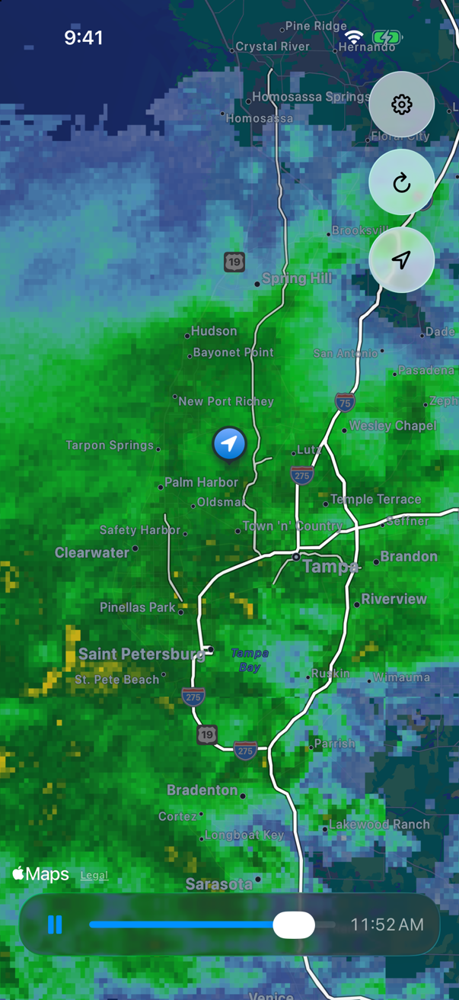
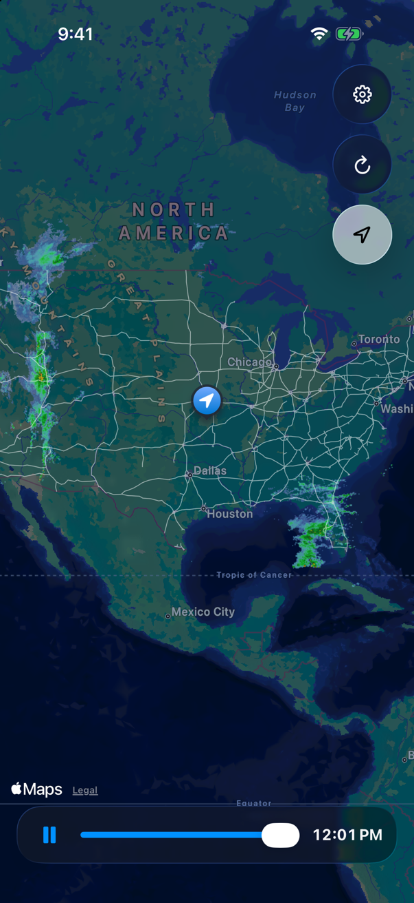
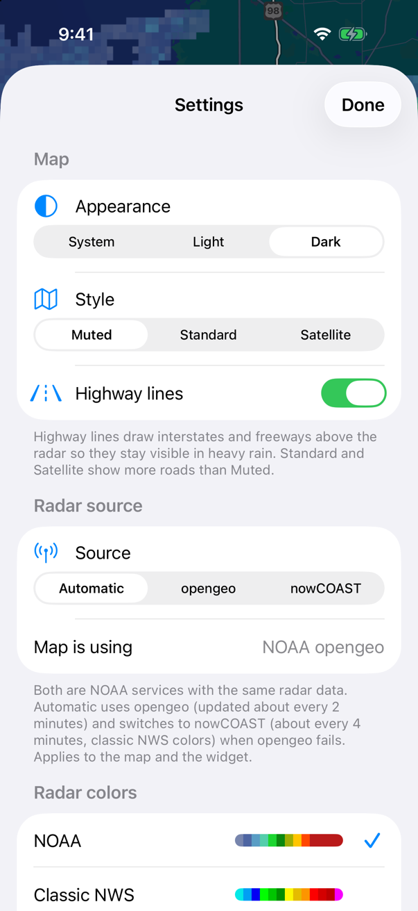

# Radar Glance

Live NOAA weather radar for the continental US, centered on where you are:

- **A widget** for the iPhone Home Screen, **StandBy**, and the **CarPlay Dashboard**, with an
  optional temperature and humidity readout.
- **An app** with a full-screen radar map that animates the last 30 minutes to 2 hours, with
  pinch-zoom, panning, highway lines that stay visible in heavy rain, and several radar color
  schemes.

Radar comes from NOAA's MRMS mosaic (opengeo, with nowCOAST as an automatic backup); temperature
and humidity come from the National Weather Service API. No accounts or API keys.

<p>
  
  
  
</p>

## Screenshots

### The widget in StandBy

The small widget (Home Screen, StandBy, and CarPlay) shows the radar around you, the radar's
time, a scale bar, the refresh button, and (optional) temperature and humidity from the nearest
NWS station. In StandBy it sits next to the clock on its dark tile.


Captured from a connected iPhone with its location simulated (so the screenshot doesn't reveal
where the phone really is):

```sh
xcrun devicectl device simulate location coordinate --device <device-udid> --latitude=28.12 --longitude=-82.6
# wait for the widget to refresh, then:
xcrun devicectl device capture screenshot --device <device-udid> --destination docs/screenshots/standby.png
xcrun devicectl device simulate location clear --device <device-udid>
```

### The app

| Dark, muted map | Light map, Classic NWS colors | Satellite, High contrast colors |
|---|---|---|
|  |  |  |

The bottom bar plays and pauses the loop and scrubs through the frames; the buttons on the right
open Settings, refresh the radar, and recenter on you. Tapping the widget opens this map.

### CarPlay

The widget is the same small widget in the CarPlay Dashboard. A CarPlay screenshot isn't
included yet. To capture one, connect the iPhone to a car or to Xcode's CarPlay Simulator (Xcode
27 Device Hub → CarPlay Simulator, iPhone connected by USB), add the widget (see below), then:

```sh
xcrun devicectl device info displays --device <device-udid>      # find the CarPlay display's unique ID
xcrun devicectl device capture screenshot --device <device-udid> \
    --display-unique-id <carplay-display-id> --destination docs/screenshots/carplay.png
```

## Requirements

- macOS with **Xcode 27** (iOS 27 SDK). The app's deployment target is **iOS 26**, the first
  version with CarPlay widgets.
- [XcodeGen](https://github.com/yonaskolb/XcodeGen) (`brew install xcodegen`). `project.yml` is the
  source of truth; the generated `RadarGlance.xcodeproj` is committed too.
- An Apple developer team for running on a device (Simulator builds need none). Signing comes
  from `Config/Signing.xcconfig`, which defaults to bundle prefix `com.example` and no team.
  Put your own values in `Config/Local.xcconfig` (git-ignored):

  ```
  DEVELOPMENT_TEAM = ABCDE12345
  BUNDLE_ID_PREFIX = com.yourname
  ```

  The app becomes `<prefix>.radarglance`, the widget `<prefix>.radarglance.widget`, and the
  shared App Group `group.<prefix>.radarglance` (read at runtime from each Info.plist's
  `AppGroupIdentifier`). Automatic signing registers them on the first device build.

## Build and test

```sh
xcodegen generate          # after editing project.yml or adding files
xcodebuild -scheme RadarGlance -destination 'generic/platform=iOS Simulator' build
xcodebuild test -scheme RadarGlance -destination 'platform=iOS Simulator,name=iPhone 17 Pro'
```

The tests (Swift Testing, `SharedTests`) cover the radar pipeline, NOAA/nowCOAST clients, color
tables, highway data, settings, and the NWS weather service, all against saved fixtures.

Or open `RadarGlance.xcodeproj` in Xcode, pick the **RadarGlance** scheme and a simulator or
device, and press Run (⌘R); ⌘U runs the tests.

## Run in the Simulator

```sh
xcrun simctl boot "iPhone 17 Pro"
xcodebuild -scheme RadarGlance -destination 'platform=iOS Simulator,name=iPhone 17 Pro' build
xcrun simctl install "iPhone 17 Pro" ~/Library/Developer/Xcode/DerivedData/RadarGlance-*/Build/Products/Debug-iphonesimulator/RadarGlance.app
xcrun simctl launch "iPhone 17 Pro" com.example.radarglance -testLocation 28.12,-82.6   # <prefix>.radarglance
```

Launch arguments (Debug builds):

| Argument | Effect |
|---|---|
| `-testLocation 35.47,-97.52` | Use this position instead of GPS (app only). |
| `-mapWidthMiles 2600` | Start the map this wide (the zoom settings stop at 160 mi). |
| `-showSettings YES` | Open Settings on launch. |

The README screenshots were taken this way, with
`xcrun simctl status_bar <sim> override --time 9:41 --batteryState charged --batteryLevel 100`
and map settings written to the App Group's `mapSettings` default.

Settings → Debug shows the BBOX, WMS URL, HTTP status, radar source, radar/fetch times, base map
reuse, alignment error, the animation's frames, the widget's last weather reading, and widget
memory readings (memory is only reported on a device).

## Deploy to an iPhone

Connect the iPhone by USB (or the same network with pairing enabled), turn on Developer Mode
(Settings → Privacy & Security → Developer Mode), then:

```sh
xcrun devicectl list devices                     # note the iPhone's identifier
xcodebuild -scheme RadarGlance -destination 'id=<device-udid>' \
    -derivedDataPath build/DerivedData -allowProvisioningUpdates build
xcrun devicectl device install app --device <device-udid> \
    build/DerivedData/Build/Products/Debug-iphoneos/RadarGlance.app
```

Open Radar Glance once and allow location **While Using** (widgets can't use location unless
the app has it).

## Add the widget

- **Home Screen:** touch and hold the Home Screen → Edit → Add Widget → Radar Glance. Small,
  medium, and large sizes are available; touch and hold the widget → Edit Widget to pick a zoom.
- **StandBy:** charge the iPhone on its side while locked. Swipe to the widgets view, touch and
  hold a widget stack, tap +, and add Radar Glance. The radar keeps its dark tile (the widget's
  background can't be removed).
- **CarPlay:** on the iPhone, Settings → General → CarPlay → your car → Widgets → add Radar
  Glance. CarPlay shows the small widget; its zoom is set in the app (Settings → Widget →
  CarPlay).

Turn on temperature and humidity in the app: Settings → Widget → Temperature & humidity.

## Data sources

| Data | Source |
|---|---|
| Radar | NOAA MRMS base reflectivity via [opengeo](https://opengeo.ncep.noaa.gov/geoserver/conus/conus_bref_qcd/ows) (WMS), updated about every 2 min |
| Radar backup | NOAA [nowCOAST](https://nowcoast.noaa.gov/) (same MRMS data, ~4 min updates); used automatically when opengeo fails |
| Temperature & humidity | [NWS API](https://www.weather.gov/documentation/services-web-api): latest observation from the nearest stations, hourly forecast as fallback |
| Base map | Apple MapKit |
| Highway lines | US Census TIGER/Line primary roads (public domain) |

Design notes are in `PLAN.md`; NOAA service details, the radar color table, and the backup are in
`docs/noaa-wms-notes.md`.

## Generated data

- `RadarGlance/Resources/highways.bin`: highway lines from US Census TIGER/Line primary roads.
  Regenerate with the commands at the top of `tools/build-highways.py`.
- `Shared/RadarPaletteTable.swift`: NOAA radar color → dBZ, measured against nowCOAST. See
  `tools/derive-radar-palette.py` and `docs/noaa-wms-notes.md`.

## Manual checks (can't be automated here)

- [ ] Run on a real iPhone with CarPlay Simulator (Xcode 27 Device Hub → CarPlay Simulator,
      iPhone connected by USB) or in a car.
- [ ] Widget renders with the iPhone **locked**.
- [ ] Refresh button works on a touchscreen head unit.
- [ ] Background stays visible in CarPlay (not removed).
- [ ] Widget extension memory: after a widget refresh, open the app's Debug section and
      check the "Memory" rows from the `widget` process stay well above 8 MB free.
- [ ] Radar animation is smooth on a device while panning and zooming the map.
- [ ] With Settings → Widget → Temperature & humidity on, the widget (Home Screen and CarPlay)
      shows "temp · humidity" top-left without crowding the refresh button.
- [ ] Highway lines and radar read well in each map style and appearance, and each color scheme
      is legible over heavy rain (needs a day with strong storms; the palette above ~40 dBZ is
      extrapolated).
- [ ] Tapping the widget (outside the refresh button) opens the app on the radar map,
      recentered on you; the refresh button still refreshes without opening the app.
- [ ] Radar edges line up with coastlines (needs a day with coastal precipitation;
      the snapshot-corner alignment check reports ~0 px).
