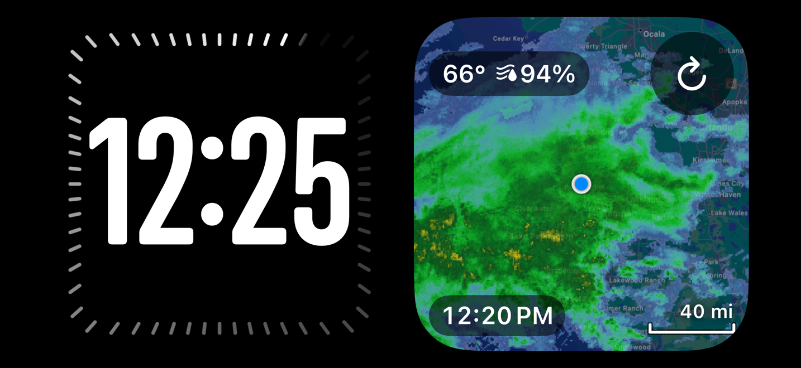
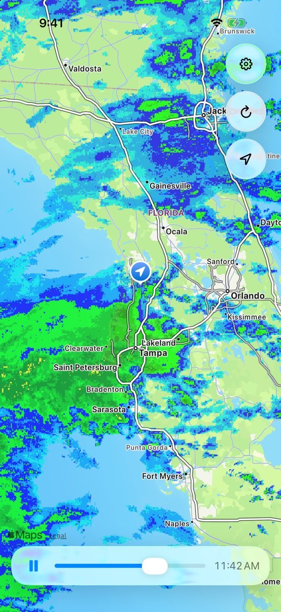
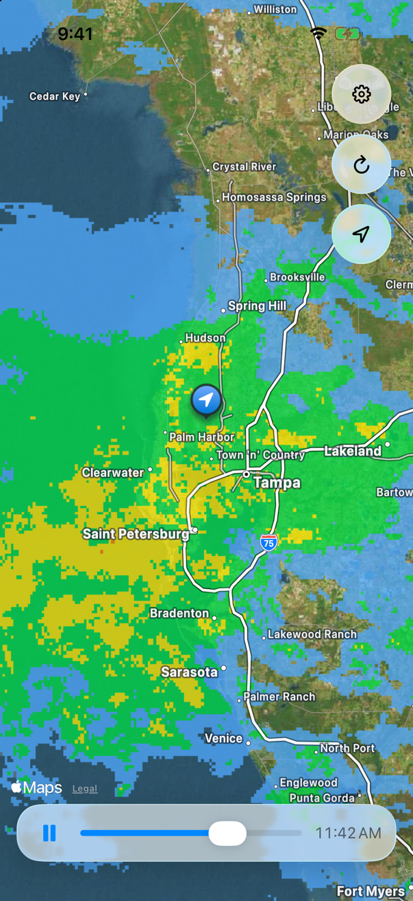
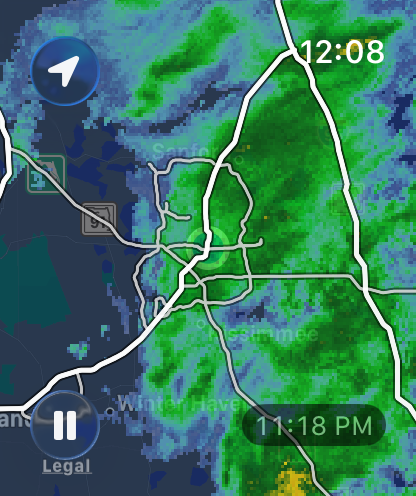
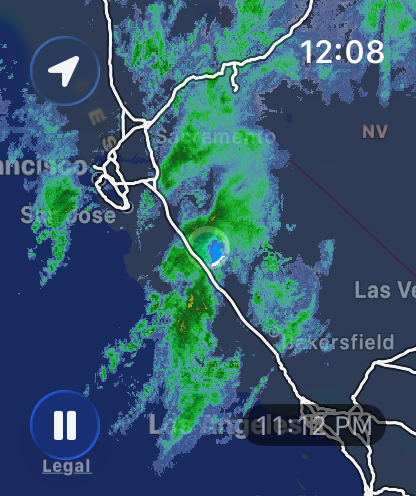
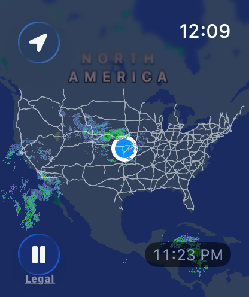

# QuickRadarGlance

Live NOAA weather radar for the continental US, centered on where you are:

- **A widget** for the iPhone Home Screen, **StandBy**, and the **CarPlay Dashboard**, with an
  optional temperature and humidity readout.
- **An app** with a full-screen radar map that animates the last 30 minutes to 2 hours, with
  pinch-zoom, panning, highway lines that stay visible in heavy rain, and several radar color
  schemes.
- **A watch app** with the same animated radar over Apple Maps: turn the Digital Crown to zoom,
  drag to pan.

Radar comes from NOAA's MRMS mosaic (opengeo, with nowCOAST as an automatic backup); temperature
and humidity come from the National Weather Service API. No accounts or API keys.

<p>
  
  
  
</p>

## Screenshots

### The widget in StandBy

The small widget (Home Screen, StandBy, and CarPlay) shows the radar around you, the radar's
time, a scale bar, the refresh button, and (optional) temperature and humidity from the nearest
NWS station. In StandBy it sits next to the clock on its dark tile.



Captured from a connected iPhone with its location simulated (so the screenshot doesn't reveal
where the phone really is):

```sh
xcrun devicectl device simulate location coordinate --device <device-udid> --latitude=28.12 --longitude=-82.6
# wait for the widget to refresh, then:
xcrun devicectl device capture screenshot --device <device-udid> --destination docs/screenshots/standby.png
xcrun devicectl device simulate location clear --device <device-udid>
```

### The app

| Dark, muted map | Light map, Classic NWS colors | Satellite, High contrast colors |
|---|---|---|
|  |  |  |

The bottom bar plays and pauses the loop and scrubs through the frames; the buttons on the right
open Settings, refresh the radar, and recenter on you. Tapping the widget opens this map.

### The watch app

| Up close (Orlando) | Regional (California) | Whole coverage area |
|---|---|---|
|  |  |  |

The Digital Crown zooms and dragging pans. The button at the top left recenters on you; the bottom
bar plays and pauses the loop and shows the frame's time. Highway lines are always drawn, thinning
as the map zooms out like on the phone.

Taken in the watch Simulator (see [Run the watch app](#run-the-watch-app) below) with the
location set by `xcrun simctl location` and the launch argument `-mapWidthMiles 90`, `450`, or
`3300`. The watch Simulator can't override its clock, so it shows the real time.

### CarPlay

The widget is the same small widget in the CarPlay Dashboard. A CarPlay screenshot isn't
included yet. To capture one, connect the iPhone to a car or to Xcode's CarPlay Simulator (Xcode
27 Device Hub → CarPlay Simulator, iPhone connected by USB), add the widget (see below), then:

```sh
xcrun devicectl device info displays --device <device-udid>      # find the CarPlay display's unique ID
xcrun devicectl device capture screenshot --device <device-udid> \
    --display-unique-id <carplay-display-id> --destination docs/screenshots/carplay.png
```

## Requirements

- macOS with **Xcode 27** (iOS 27 SDK). The app's deployment target is **iOS 26**, the first
  version with CarPlay widgets.
- [XcodeGen](https://github.com/yonaskolb/XcodeGen) (`brew install xcodegen`). `project.yml` is the
  source of truth; the generated `QuickRadarGlance.xcodeproj` is committed too.
- An Apple developer team for running on a device (Simulator builds need none). Signing comes
  from `Config/Signing.xcconfig`, which defaults to bundle prefix `com.example` and no team.
  Put your own values in `Config/Local.xcconfig` (git-ignored):

  ```
  DEVELOPMENT_TEAM = ABCDE12345
  BUNDLE_ID_PREFIX = com.yourname
  ```

  The app becomes `<prefix>.quickradarglance`, the widget `<prefix>.quickradarglance.widget`, the
  watch app `<prefix>.quickradarglance.watchkitapp`, and the shared App Group
  `group.<prefix>.quickradarglance` (read at runtime from each Info.plist's `AppGroupIdentifier`).
  Automatic signing registers them on the first device build.

## Build and test

```sh
xcodegen generate          # after editing project.yml or adding files
xcodebuild -scheme QuickRadarGlance -destination 'generic/platform=iOS Simulator' build
xcodebuild test -scheme QuickRadarGlance -destination 'platform=iOS Simulator,name=iPhone 17 Pro'
```

The tests (Swift Testing, `SharedTests`) cover the radar pipeline, NOAA/nowCOAST clients, color
tables, highway data, settings, and the NWS weather service, all against saved fixtures.

Or open `QuickRadarGlance.xcodeproj` in Xcode, pick the **QuickRadarGlance** scheme and a simulator or
device, and press Run (⌘R); ⌘U runs the tests.

## Run in the Simulator

```sh
xcrun simctl boot "iPhone 17 Pro"
xcodebuild -scheme QuickRadarGlance -destination 'platform=iOS Simulator,name=iPhone 17 Pro' build
xcrun simctl install "iPhone 17 Pro" ~/Library/Developer/Xcode/DerivedData/QuickRadarGlance-*/Build/Products/Debug-iphonesimulator/QuickRadarGlance.app
xcrun simctl launch "iPhone 17 Pro" com.example.quickradarglance -testLocation 28.12,-82.6   # <prefix>.quickradarglance
```

Launch arguments (Debug builds):

| Argument | Effect |
|---|---|
| `-testLocation 35.47,-97.52` | Use this position instead of GPS (app only). |
| `-mapWidthMiles 2600` | Start the map this wide (the zoom settings stop at 160 mi). Also works for the watch app. |
| `-showSettings YES` | Open Settings on launch. |

The README screenshots were taken this way, with
`xcrun simctl status_bar <sim> override --time 9:41 --batteryState charged --batteryLevel 100`
and map settings written to the App Group's `mapSettings` default.

### Run the watch app

The watch app has its own scheme and runs on its own (it fetches radar itself; the phone only
relays the network when nearby). In the watch Simulator, the scroll wheel or trackpad scroll is
the Digital Crown.

```sh
xcrun simctl boot "Apple Watch Series 11 (46mm)"
xcodebuild -scheme QuickRadarGlanceWatch -destination 'platform=watchOS Simulator,name=Apple Watch Series 11 (46mm)' \
    -derivedDataPath build/DerivedData build
xcrun simctl install "Apple Watch Series 11 (46mm)" build/DerivedData/Build/Products/Debug-watchsimulator/QuickRadarGlanceWatch.app
xcrun simctl location "Apple Watch Series 11 (46mm)" set 25.95,-80.25
xcrun simctl launch "Apple Watch Series 11 (46mm)" com.example.quickradarglance.watchkitapp
```

watchOS maps can't draw overlays, so the radar frame is an image laid over the map and moved with
it on every camera change. Highway lines are drawn the same way, always on, so the radar keeps its
landmarks even when the watch can't load map tiles. The watch uses the default map settings and
keeps its own loop length.

Settings → Debug shows the BBOX, WMS URL, HTTP status, radar source, radar/fetch times, base map
reuse, alignment error, the animation's frames, the widget's last weather reading, and widget
memory readings (memory is only reported on a device).

## Deploy to an iPhone

Connect the iPhone by USB (or the same network with pairing enabled), turn on Developer Mode
(Settings → Privacy & Security → Developer Mode), then:

```sh
xcrun devicectl list devices                     # note the iPhone's identifier
xcodebuild -scheme QuickRadarGlance -destination 'id=<device-udid>' \
    -derivedDataPath build/DerivedData -allowProvisioningUpdates build
xcrun devicectl device install app --device <device-udid> \
    build/DerivedData/Build/Products/Debug-iphoneos/QuickRadarGlance.app
```

Open QuickRadarGlance once and allow location **While Using** (widgets can't use location unless
the app has it).

The watch app is embedded in the iPhone app. Once the iPhone app is installed, it appears in the
Watch app on the iPhone (My Watch → Available Apps) if it doesn't install automatically.

To install straight onto the watch instead, turn on Developer Mode on the watch too, keep its
Wi-Fi on (the Mac reaches it over the network), and build with the watch as the destination. That
build also registers the watch with your team; until then its install fails with "This
provisioning profile cannot be installed on this device".

```sh
xcrun devicectl list devices                     # note the watch's identifier
xcodebuild -scheme QuickRadarGlanceWatch -destination 'id=<watch-udid>' \
    -derivedDataPath build/DerivedData -allowProvisioningUpdates build
xcrun devicectl device install app --device <watch-udid> \
    build/DerivedData/Build/Products/Debug-watchos/QuickRadarGlanceWatch.app
```

## Publish to TestFlight

The project is set up for App Store Connect: a privacy manifest in the app, widget and Shared
framework (UserDefaults reasons CA92.1 and 1C8F.1; coarse location for app functionality, not
linked or tracked), `ITSAppUsesNonExemptEncryption = NO` (HTTPS only), an opaque 1024 px icon,
and Info.plist versions taken from `MARKETING_VERSION` / `CURRENT_PROJECT_VERSION`.

1. **Apple Developer Program** membership (paid) and `Config/Local.xcconfig` with your team and
   bundle prefix (see [Requirements](#requirements)).
2. **App Store Connect → Apps → +**: New App, platform iOS, bundle ID
   `<prefix>.quickradarglance` (it appears after one device build or archive registers it),
   a name (must be unique on the App Store), and a SKU.
3. **Archive and upload** (Apple ID signed in to Xcode → Settings → Accounts, or an App Store
   Connect API key):

   ```sh
   tools/archive-testflight.sh                 # archive, sign for the App Store, upload
   tools/archive-testflight.sh --export-only   # dry run: build/testflight/export/QuickRadarGlance.ipa
   ASC_KEY_PATH=~/keys/AuthKey_ABC123.p8 ASC_KEY_ID=ABC123 ASC_ISSUER_ID=<issuer-uuid> \
       tools/archive-testflight.sh             # upload with an API key instead
   ```

   The build number is the UTC time (e.g. `20261117.2135`), so each upload is higher than the
   last; raise `MARKETING_VERSION` in `project.yml` for a new version. In Xcode instead: select
   *Any iOS Device*, Product → Archive, then Distribute App → TestFlight & App Store.
4. **TestFlight**: after processing (5–30 min), add **internal testers** (members of your App
   Store Connect team; no review). For **external testers** (email or public link), fill in Test
   Information (what to test, feedback email; a privacy policy URL may be requested) and submit
   the build for Beta App Review. The App Privacy section matches the manifest: *Coarse
   Location — App Functionality, not linked to the user, not used for tracking*.

Testers need iOS 26 or later and the TestFlight app. Builds expire after 90 days.

## Add the widget

- **Home Screen:** touch and hold the Home Screen → Edit → Add Widget → QuickRadarGlance. Small,
  medium, and large sizes are available; touch and hold the widget → Edit Widget to pick a zoom.
- **StandBy:** charge the iPhone on its side while locked. Swipe to the widgets view, touch and
  hold a widget stack, tap +, and add QuickRadarGlance. The radar keeps its dark tile (the widget's
  background can't be removed).
- **CarPlay:** on the iPhone, Settings → General → CarPlay → your car → Widgets → add Radar
  Glance. CarPlay shows the small widget; its zoom is set in the app (Settings → Widget →
  CarPlay).

Turn on temperature and humidity in the app: Settings → Widget → Temperature & humidity.

## Data sources

| Data | Source |
|---|---|
| Radar | NOAA MRMS base reflectivity via [opengeo](https://opengeo.ncep.noaa.gov/geoserver/conus/conus_bref_qcd/ows) (WMS), updated about every 2 min |
| Radar backup | NOAA [nowCOAST](https://nowcoast.noaa.gov/) (same MRMS data, ~4 min updates); used automatically when opengeo fails |
| Temperature & humidity | [NWS API](https://www.weather.gov/documentation/services-web-api): latest observation from the nearest stations, hourly forecast as fallback |
| Base map | Apple MapKit |
| Highway lines | US Census TIGER/Line primary roads (public domain) |


## Generated data

- `QuickRadarGlance/Resources/highways.bin`: highway lines from US Census TIGER/Line primary roads.
  Regenerate with the commands at the top of `tools/build-highways.py`.
- `Shared/RadarPaletteTable.swift`: NOAA radar color → dBZ, measured against nowCOAST. See
  `tools/derive-radar-palette.py` for the method.

## Manual checks (can't be automated here)

- [ ] Run on a real iPhone with CarPlay Simulator (Xcode 27 Device Hub → CarPlay Simulator,
      iPhone connected by USB) or in a car.
- [ ] Widget renders with the iPhone **locked**.
- [ ] Refresh button works on a touchscreen head unit.
- [ ] Background stays visible in CarPlay (not removed).
- [ ] Widget extension memory: after a widget refresh, open the app's Debug section and
      check the "Memory" rows from the `widget` process stay well above 8 MB free.
- [ ] Radar animation is smooth on a device while panning and zooming the map.
- [ ] With Settings → Widget → Temperature & humidity on, the widget (Home Screen and CarPlay)
      shows "temp · humidity" top-left without crowding the refresh button.
- [ ] Highway lines and radar read well in each map style and appearance, and each color scheme
      is legible over heavy rain (needs a day with strong storms; the palette above ~40 dBZ is
      extrapolated).
- [ ] Tapping the widget (outside the refresh button) opens the app on the radar map,
      recentered on you; the refresh button still refreshes without opening the app.
- [ ] On a real Apple Watch: the Digital Crown zooms, dragging pans, the radar keeps up with the
      map while moving, and memory stays reasonable during a 2 hr loop (63 MB in the Simulator
      with a 1 hr loop).
- [ ] Radar edges line up with coastlines (needs a day with coastal precipitation;
      the snapshot-corner alignment check reports ~0 px).
